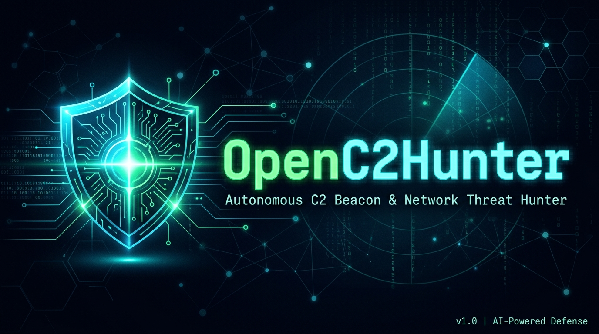

# OpenC2Hunter

<p align="center">
  
</p>

<p align="center">
  <strong>Autonomous AI-Powered C2 Beacon & Pre-Compromise Network Threat Hunter</strong>
</p>

<p align="center">
  
  
  
  
  
  
</p>

---

OpenC2Hunter monitors your live network traffic in real-time, detects **Command & Control (C2) beacons**, **DGA-generated malicious domains**, and **suspicious outbound connections** — **before attackers get a foothold**. Runs entirely on your local machine with zero cloud dependency.

---

## 🚀 What It Does

| Capability | Description |
|---|---|
| 🔍 **Live Sniffing & PCAP Replay** | Captures live TCP/UDP flows or analyzes uploaded `.pcap`/`.pcapng` forensic dumps |
| 🤖 **C2 Beacon Detection** | Detects periodic beaconing via inter-arrival time (IAT) + jitter analysis |
| 🧬 **DGA Domain Detection** | Shannon entropy analysis flags algorithmically-generated malicious domains |
| 🗺️ **MITRE ATT&CK Enterprise Matrix** | Maps telemetry to 8 core ATT&CK techniques with an interactive SOC matrix |
| 🧠 **AI Threat Analyst Copilot** | Synthesizes contextual adversary attribution, kill chain phases & playbook |
| 📦 **Forensic Triage Bundles** | One-click ZIP extraction of executive report, IOC JSON, sockets CSV & memory strings |
| 🛡️ **Host Quarantine Isolation** | Emergency network isolation cutting off external C2 while keeping local SOC links |
| 🔄 **Threat Intel Feed Auto-Sync** | Sub-millisecond SQLite cache syncing known active C2 IPs from Abuse.ch Feodo & SSLBL |
| 🍯 **Dynamic Canary Honeypots** | Spin up decoy listeners (RDP, Docker, WinRM, SSH, Redis) to detect lateral probes |
| 🧠 **Memory String Forensics** | Inspects live process memory / loaded binaries for extracted URLs, IPs & C2 markers |
| 📦 **STIX 2.1 & YARA Export** | Generates OASIS STIX 2.1 JSON threat bundles, YARA rules, and Sigma rules |
| 📢 **Tactical Audio & Webhooks** | Real-time WebSocket streaming, Web Audio radar alarm, and Discord/Slack dispatches |
| 🔥 **Persistent One-Click Containment**| Kills malicious processes & permanently blocks outbound IPs via OS firewall |
| 🛡️ **Hardened SOC Access Gateway** | PBKDF2-HMAC-SHA256 password hashing, anti-brute-force rate limiting & token auth |

---

## 🖼️ Architecture

```
┌─────────────────────────────────────────────────────┐
│                   Your Machine                       │
│                                                     │
│  ┌─────────────┐    ┌──────────────────────────┐   │
│  │  Sniffer    │───▶│   FastAPI Backend         │   │
│  │  Daemon     │    │   (Port 8000)             │   │
│  │  (Scapy)    │    │   • Flow aggregation      │   │
│  └─────────────┘    │   • DGA detection         │   │
│                     │   • OSINT enrichment      │   │
│  ┌─────────────┐    │   • Mitigation engine     │   │
│  │  Canary     │───▶│                           │   │
│  │  Honeypots  │    └──────────┬───────────────┘   │
│  └─────────────┘               │                    │
│                     ┌──────────▼───────────────┐   │
│                     │   React Dashboard         │   │
│                     │   (Port 3000)             │   │
│                     │   • Live threat feed      │   │
│                     │   • Risk scoring          │   │
│                     │   • 1-click block         │   │
│                     └──────────────────────────┘   │
└─────────────────────────────────────────────────────┘
```

---

## ⚡ Quick Start

### Option 1 — Native (Windows / Linux / macOS) ✅ Recommended

**Step 1:** Clone the repo
```bash
git clone https://github.com/Yoonas18/OpenC2Hunter.git
cd OpenC2Hunter
```

**Step 2:** Copy environment config
```bash
cp .env.example .env
```

**Step 3:** Install backend dependencies
```bash
pip install -r backend/requirements.txt
```

**Step 4:** Install frontend dependencies
```bash
cd frontend && npm install && cd ..
```

**Step 5:** Launch (run as **Administrator/sudo** for full packet capture)

- **Windows** (PowerShell as Administrator):
```powershell
python launch.py
```

- **Linux / macOS**:
```bash
sudo python3 launch.py
```

**Step 6:** Open your browser → **http://127.0.0.1:3000** 🎉

Login using your Superadmin credentials (see below).

---

## 🔐 Superadmin Lab Access & Authentication

OpenC2Hunter includes an enterprise-grade SOC access gateway protecting all API endpoints and workbench telemetry:

| Credential | Value | Config (.env) |
|---|---|---|
| **Default Username** | `superadmin` | `ADMIN_USERNAME=superadmin` |
| **Default Password** | `OpenC2Hunter@2026!` | `ADMIN_PASSWORD=your_secure_password` |
| **Session Lifetime** | 24 Hours | Cryptographically secure token (`token_urlsafe(32)`) |
| **Brute-Force Guard** | Active | Rate-limits & locks gateway for 5 mins after 5 failed attempts |

### Changing Credentials
To set your own custom superadmin credentials, add them to your `.env` file:
```env
ADMIN_USERNAME=superadmin
ADMIN_PASSWORD=YourSuperSecretPassword#2026!
```

---

### Option 2 — Docker 🐳

```bash
cp .env.example .env
docker compose up --build -d
```

Then open **http://127.0.0.1:3000**

---

## 🔑 Optional API Keys (BYOK)

All external lookups are cached locally in SQLite — free tiers work fine.

Edit your `.env` file:

```env
# VirusTotal — file hash reputation (free tier: 4 req/min)
VT_API_KEY=your_vt_key_here

# Abuse.ch ThreatFox — C2 IOC intel (free)
ABUSE_CH_KEY=your_abusech_key_here

# URLScan.io — URL detonation sandbox (free tier available)
URLSCAN_API_KEY=your_urlscan_key_here

# Enable honeypot canary traps (optional)
ENABLE_CANARIES=true
```

> **No keys needed to start.** The tool works out of the box using Shodan InternetDB (no auth) and local URLhaus feed.

---

## 🍯 Canary Honeypot Mode

Enable fake service listeners that catch internal lateral movement:

```bash
# Windows (Admin)
python launch.py --enable-canaries

# Linux/macOS
sudo python3 launch.py --enable-canaries
```

Any connection to the fake ports (SSH, RDP, SMB, WinRM, etc.) fires an instant alert on your dashboard.

---

## 🧪 Running Tests

```bash
pytest backend/tests/ -v
```

| Test | What It Validates |
|---|---|
| `test_dga_entropy_math_accuracy` | Shannon entropy correctly flags DGA domains |
| `test_private_target_privacy_filter` | Private IPs & internal hosts are never analyzed/blocked |
| `test_csrf_protection_blocks_unauthenticated_requests` | API rejects missing / wrong session tokens |
| `test_mitigate_refuses_private_ips_and_critical_pids` | Mitigation engine refuses to block safe IPs or system PIDs |
| `test_superadmin_auth_flow` | PBKDF2 hash verification, session login/logout & rate limiting |
| `test_pbkdf2_password_hashing` | Secure PBKDF2 derivative key calculation and verification |
| `test_stix_and_yara_export` | Valid OASIS STIX 2.1 JSON bundle & YARA syntax validation |
| `test_canary_traps_management` | Decoy honeypot listeners configuration & port management |
| `test_process_memory_inspector` | Safe regex extraction of URLs, IPs & base64/hex markers from binaries |
| `test_mitre_attack_mapping_and_matrix` | Validates mapping of live flows to ATT&CK techniques & tactics summary |
| `test_incident_response_triage_bundle` | Generates verified .zip triage bundle with Markdown report & CSV sockets |
| `test_ai_threat_analyst_copilot` | Contextual LLM/heuristic reasoning, attribution hypothesis & playbooks |
| `test_threat_intel_cache_offline_lookup` | Sub-millisecond SQLite query against Feodo/curated threat intelligence |

---

## 🗂️ Project Structure

```
OpenC2Hunter/
├── backend/
│   ├── backend_engine.py      # FastAPI REST API + CSRF auth + OSINT enrichment + WebSocket
│   ├── sniffer_daemon.py      # Live packet capture + C2 beacon + DGA detection
│   ├── forensic_pcap.py       # Offline .pcap/.pcapng replay & deep flow reconstruction
│   ├── mitre_attack.py        # MITRE ATT&CK Matrix mapping & TTP aggregator
│   ├── incident_response.py   # Forensic triage bundle (.zip) builder & host isolation
│   ├── ai_threat_analyst.py   # Autonomous SOC AI copilot & heuristic reasoning engine
│   ├── threat_intel_feed.py   # Feodo Tracker & SSLBL SQLite feed sync and lookup
│   ├── process_memory.py      # Live memory/binary string extraction (URLs, IPs, C2 indicators)
│   ├── threat_export.py       # STIX 2.1 JSON bundle & YARA rule exporter
│   ├── webhooks.py            # Discord & Slack enterprise SOC alert delivery
│   ├── url_analyzer.py        # URL/domain threat analysis + URLhaus feed
│   ├── canary_deception.py    # Dynamic decoy honeypot trap engine
│   ├── schema.sql             # SQLite schema (flows, processes, threat intel, blocked_ips)
│   ├── requirements.txt       # Python dependencies
│   └── tests/
│       └── test_core.py       # Pytest unit test suite (13 test cases)
├── frontend/
│   └── src/
│       ├── ThreatHunterDashboard.jsx  # React dashboard + MITRE + AI Copilot + Triage UI
│       └── main.jsx                   # App entry point
├── .env.example               # Environment variable template
├── docker-compose.yml         # Docker setup
├── launch.py                  # One-command native launcher
└── README.md
```

---

## 🛡️ Detection Logic

### C2 Beacon Detection
A flow is flagged as a **C2 beacon** when:
- `session_count >= 6` (repeated connections)
- `jitter_pct < 20%` (very regular timing — like automated malware)
- `avg_inter_arrival_time >= 5s` (periodic check-in rhythm)

### DGA Domain Detection
Shannon entropy is computed on the hostname label:
- Entropy **> 3.5 bits/char** → flagged as DGA-generated
- Legitimate domains (google.com, cloudflare.com) score safely below threshold

### OSINT Risk Scoring
| Source | Trigger | Risk Added |
|---|---|---|
| Shodan InternetDB | Tags: `c2`, `malware`, `tor`, `compromised` | +60 |
| ThreatFox (Abuse.ch) | IOC match | → 95 |
| VirusTotal | Malicious detections > 0 | +40 to +100 |
| URLhaus | Known malware URL | → 100 |

---

## ⚙️ API Reference

All endpoints require the `X-OpenC2-Token` header (auto-set by the UI).

| Method | Endpoint | Description |
|---|---|---|
| `POST` | `/api/v1/auth/login` | Authenticate with superadmin credentials & receive session token |
| `GET` | `/api/v1/auth/verify` | Validate existing session token |
| `POST` | `/api/v1/auth/logout` | Revoke session token & lock lab |
| `GET` | `/api/v1/graph-stats` | Get all live flows with risk scores & persisted blocked IPs |
| `GET` | `/api/v1/blocked-ips` | Get list of contained IP addresses from persistent SQLite store |
| `GET` | `/api/v1/analyze-url?target=<url>` | Analyze a URL/domain for threats |
| `GET` | `/api/v1/canary-alerts` | Get honeypot canary alert log |
| `GET` | `/api/v1/canary/traps` | List all active decoy listeners |
| `POST` | `/api/v1/canary/add-trap` | Deploy a custom decoy port listener dynamically |
| `POST` | `/api/v1/forensics/upload-pcap` | Upload offline `.pcap`/`.pcapng` dump for automated forensic extraction |
| `GET` | `/api/v1/process-memory-strings?pid=<pid>` | Scan process memory for extracted C2 URLs, external IPs & markers |
| `GET` | `/api/v1/export/stix` | Export current threat indicators as an OASIS STIX 2.1 JSON bundle |
| `GET` | `/api/v1/export/yara?flow_id=<id>` | Generate detection YARA rule with process & C2 IOC strings |
| `POST` | `/api/v1/webhooks/test` | Test dispatch an alert to configured Discord / Slack webhook URLs |
| `GET` | `/api/v1/mitre/matrix` | Aggregated MITRE ATT&CK enterprise coverage and active hits |
| `POST` | `/api/v1/incident/triage-bundle` | Download full forensic ZIP package (report, JSON IOCs, CSV sockets) |
| `POST` | `/api/v1/incident/quarantine` | Emergency host isolation (blocks external traffic except SOC links) |
| `POST` | `/api/v1/ai/investigate` | Autonomous AI Threat Analyst Copilot investigation brief & playbook |
| `POST` | `/api/v1/threat-intel/sync` | Sync known C2 indicators from Abuse.ch Feodo Tracker & SSLBL |
| `GET` | `/api/v1/threat-intel/check?indicator=<ip>`| Sub-millisecond local threat intelligence cache query |
| `WS` | `/ws/telemetry` | WebSocket stream for live sub-second flow & threat push events |
| `POST` | `/api/v1/mitigate?dst_ip=<ip>&pid=<pid>` | Block IP + terminate process + persist in DB |

---

## 🔒 Security Design

- **Localhost-only binding** — API never exposes to the network
- **CSRF session token** — Random `secrets.token_urlsafe(32)` per launch, verified on every write
- **Private IP guard** — Refuses to block/analyze `RFC-1918`, loopback, or DNS infra IPs
- **Critical PID protection** — Will never terminate system processes (`lsass.exe`, `systemd`, PID ≤ 4, etc.)
- **No telemetry** — Zero data leaves your machine unless you configure BYOK API keys

---

## 🖥️ Supported Platforms

| Platform | Packet Capture | Firewall Block |
|---|---|---|
| Windows 10/11 | ✅ (Admin) | ✅ `netsh advfirewall` |
| Ubuntu / Debian | ✅ (root) | ✅ `iptables` |
| macOS | ✅ (sudo) | ✅ `pfctl` |
| Docker (Linux) | ✅ | ✅ |

> **Without admin/root:** The sniffer falls back to socket-level capture. The dashboard, OSINT enrichment, URL analysis, and manual mitigation all still work.

---

## 🤝 Contributing

Pull requests are welcome! For major changes, please open an issue first.

1. Fork the repo
2. Create your branch: `git checkout -b feature/my-feature`
3. Commit your changes: `git commit -m 'Add my feature'`
4. Push to the branch: `git push origin feature/my-feature`
5. Open a Pull Request

---

## 📄 License

MIT License — see [LICENSE](LICENSE) for details.

---

## ⚠️ Legal Disclaimer

This tool is intended for **defensive security, network monitoring, and educational purposes only**. Only run it on networks and systems you own or have explicit written permission to monitor. The authors are not responsible for misuse.

---

*Built with ❤️ for defenders — catch threats before they catch you.*
